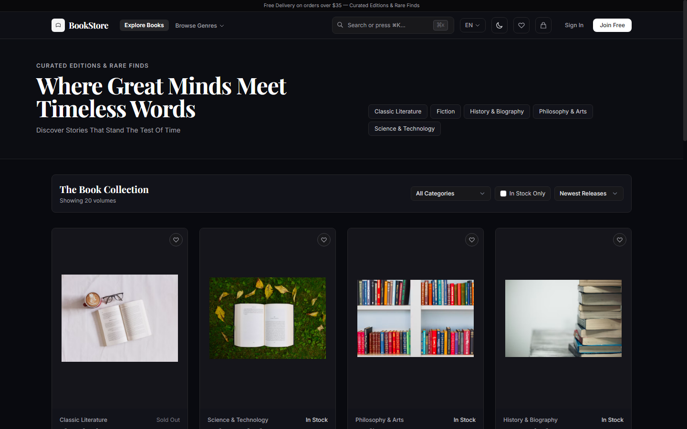
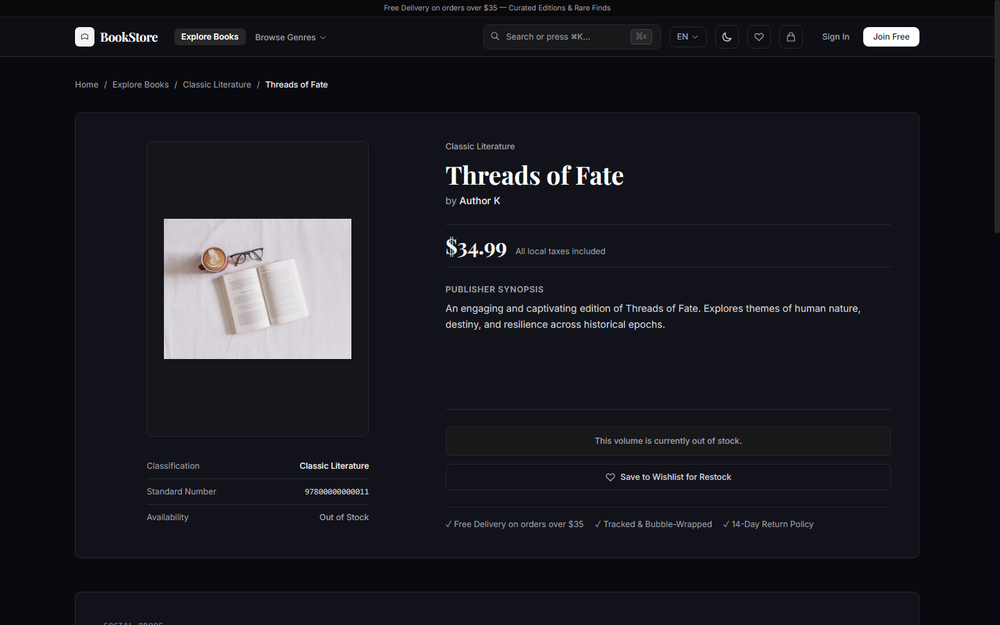
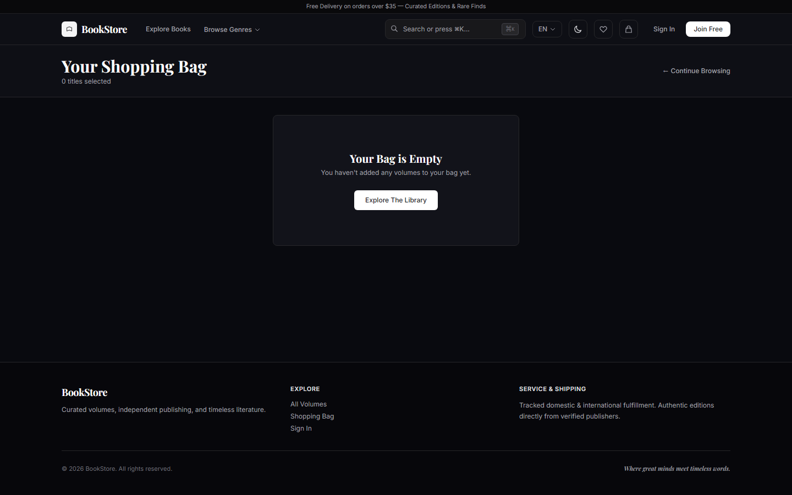
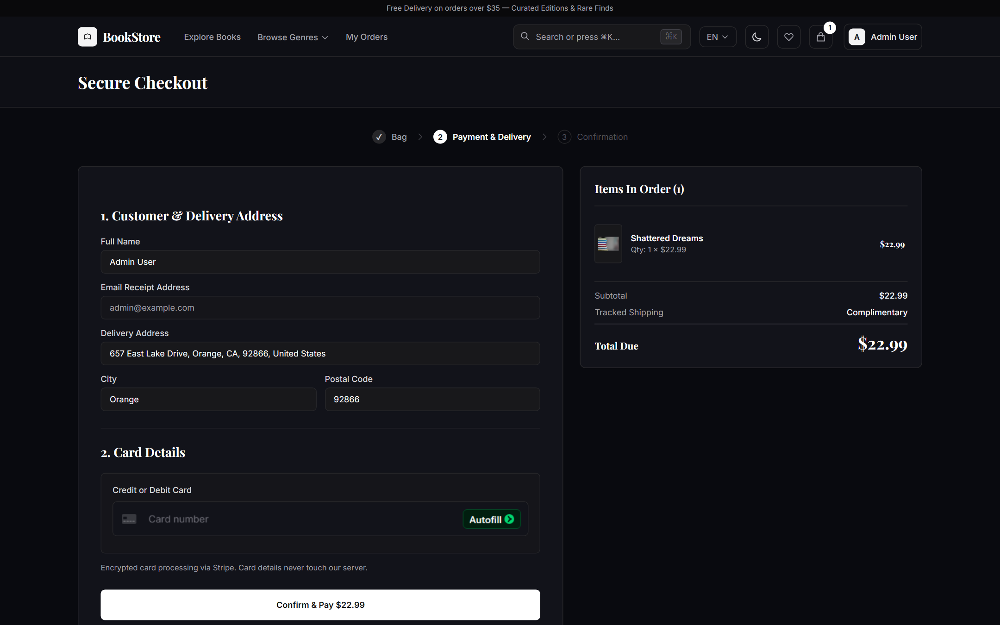
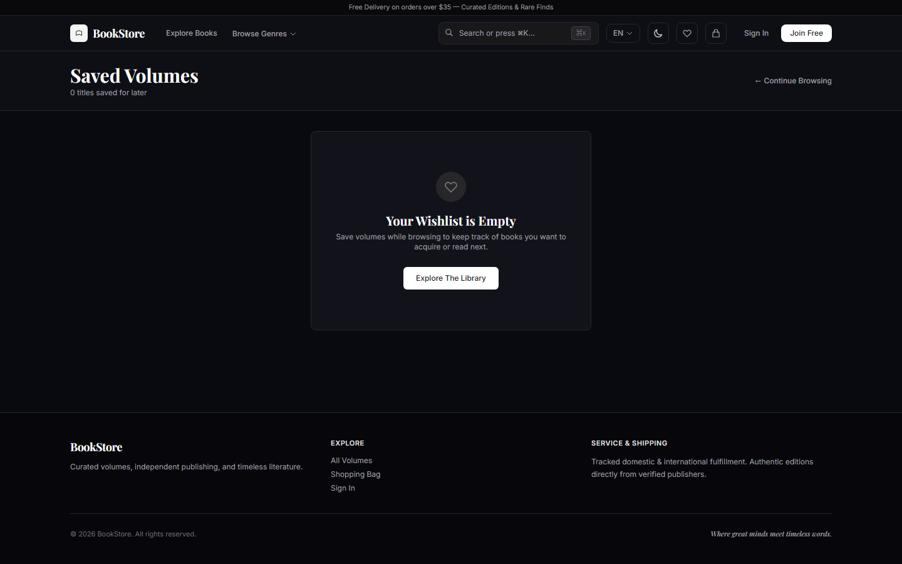
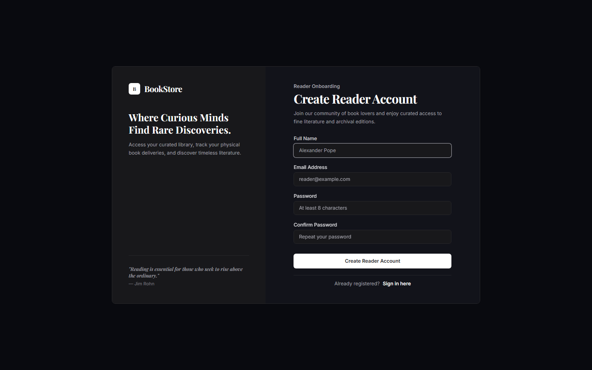
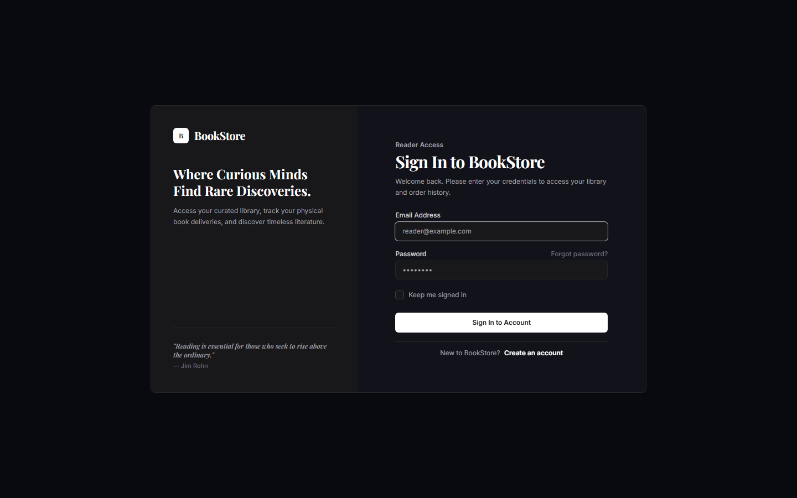
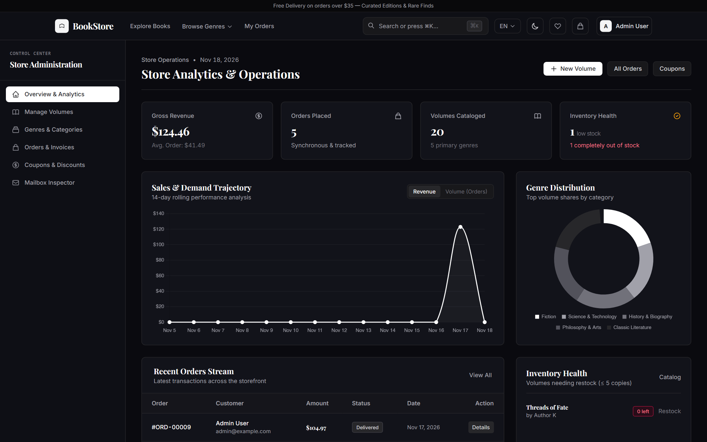
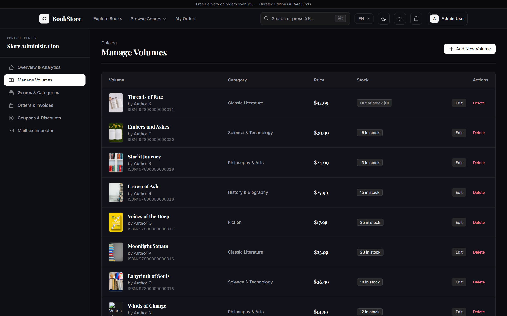

<div align="center">

# 📚 BookStore · Curated Literary Marketplace & E-Commerce Platform

### 🎓 Individual Final Exam Project · CSFTK Tunis
**Centre Sectoriel de Formation en Télécommunications de la Cité El Khadra (CSFTK Tunis)**  
*Département Informatique & Développement Web*

[](https://laravel.com)
[](https://php.net)
[](https://tailwindcss.com)
[](https://stripe.com)
[-10B981?style=for-the-badge&logo=githubactions&logoColor=white)]()
[](https://bookstores.up.railway.app)

[🌐 Live Production Demo](https://bookstores.up.railway.app) &nbsp;|&nbsp; [📖 Evaluator's Guide](#-evaluators--jury-quick-guide) &nbsp;|&nbsp; [⚡ Feature Matrix](#-comprehensive-feature-matrix) &nbsp;|&nbsp; [📸 Visual Showcase](#-visual-showcase) &nbsp;|&nbsp; [🚀 Local Installation](#-installation--local-development)

</div>

---

## 🏛️ Project Identification & Context

| Attribute | Details |
| :--- | :--- |
| **Institution** | **CSFTK Tunis** (Centre Sectoriel de Formation en Télécommunications de la Cité El Khadra) |
| **Project Nature** | **Individual Practical Exam Project** (Projet d'Examen Individuel) |
| **Target Sector** | Modern Web Engineering, Enterprise E-Commerce, Concurrency & Security Architecture |
| **Live Environment** | Hosted on **Railway Cloud** with MySQL, SSL termination, and Resend HTTPS mail integration |
| **Production URL** | **[https://bookstores.up.railway.app](https://bookstores.up.railway.app)** |

> [!NOTE]
> This application was architected and implemented as an **individual capstone exam project** for **CSFTK Tunis**. It demonstrates mastery of modern full-stack web application development: domain modeling, database transaction isolation (pessimistic locking), multi-channel asynchronous authentication, third-party payment integration (Stripe), server-side PDF document generation, and rigorous test-driven verification.

---

## 🧭 Evaluator's & Jury Quick Guide

For examiners, instructors, or evaluators wishing to test the platform without local setup, follow this 3-minute guided workflow on the [Live Production Deployment](https://bookstores.up.railway.app):

### 🔑 Pre-Seeded Evaluation Credentials

| Role | Email | Password | Access Level |
| :--- | :--- | :--- | :--- |
| **Administrator** | `admin@example.com` | `password` | Full Administrative Suite (`/admin`), inventory CRUD, fulfillment, and mailbox inspector |
| **Verified Customer** | `customer@example.com` | `password` | Active customer with pre-loaded order history, wishlist, and shipping addresses |

### 🧪 Suggested Evaluation Scenarios

1. **Reader Discovery & Reading Sample ("Look Inside"):**
   - Navigate to `/books`, choose any title (e.g., *Threads of Fate*).
   - Click **"Look Inside (Sample Excerpt)"** to launch the typography reader modal. Adjust font sizes, switch between Serif/Sans, and test full-screen reading mode.
2. **Persistent Wishlist & Guest Migration:**
   - In an incognito window as a guest, click the heart icon on any 2 books.
   - Go to `/login` and sign in as `customer@example.com` — notice that your guest wishlist items are automatically migrated and merged into the user account.
3. **Cart & Promotional Coupon Engine:**
   - Add books to the cart and apply coupon code `WELCOME10` (10% off) or `SAVE5` ($5 off). Subtotals, discounts, and tax calculate in real time.
4. **Stripe Checkout & Automated PDF Invoicing:**
   - Complete checkout using Stripe demo cards.
   - View your order history under `/orders`, click **"Download Tax Invoice (PDF)"** to inspect the server-side generated DomPDF receipt.
5. **Fulfillment Tracking Lifecycle:**
   - Sign in as `admin@example.com` and open `/admin/orders`.
   - Update an order from `Processing` to `Shipped`, assign carrier (`DHL Express`) and a tracking code.
   - Switch back to customer view to see the interactive status timeline update.
6. **60-Minute Signed Email Verification & Sandbox Simulator:**
   - Register a new account at `/register`. The account is immediately placed **On Hold** for 60 minutes.
   - To verify without waiting for external mail, click **"⚡ Activate Account Instantly"** on screen, or inspect incoming tokens at `/admin/mailbox`.

---

## 📸 Visual Showcase

### 1. Curated Homepage & Editorial Catalog
> Clean layout adhering to editorial design principles: Fraunces serif headlines, stone palette, search, genre filter pills, and live availability indicators.



---

### 2. Book Detail, Excerpt Reader & Verified Buyer Reviews
> Detailed bibliographic metadata, verified buyer ratings, helpfulness vote counters, and the interactive reading modal.



---

### 3. Shopping Bag & Stripe Checkout
> High-clarity checkout flow featuring dynamic coupon redemption, pessimistic stock locking, and Stripe Elements integration.

<p align="center">
  
  
</p>

---

### 4. Reader Wishlist & Multi-Device Synchronization
> Persistent wishlist supporting both session-based guest caching and relational database storage for authenticated members.



---

### 5. Reader Onboarding & Authentication Security
> Account security with real-time password strength verification, 60-minute signed activation links, and session revocation tools.

<p align="center">
  
  
</p>

---

### 6. Administrative Operations Suite
> Full management control: sales analytics, inventory CRUD with image uploads, coupon parameters, and shipping tracking dispatch.

<p align="center">
  
  
</p>

---

## ✨ Comprehensive Feature Matrix

### 📖 Reader & E-Commerce Experience
- **Editorial Typography & Dark Mode:** Designed with bespoke typography (Fraunces serif + Inter sans) and a zero-flicker anti-FOUC dark mode script with local storage persistence.
- **Trilingual Support (EN / FR / AR RTL):** Native locale switcher supporting English, French, and Arabic with comprehensive right-to-left (RTL) stylesheet mirroring.
- **Interactive Sample Reading Modal ("Look Inside"):** Distraction-free chapter reader with adjustable font sizing, sans/serif font switches, progress tracking, and full-screen view.
- **Verified Reviews & Star Rating Engine:** 5-star rating aggregates, verified buyer badges linked to order history, helpfulness voting, and duplicate protection.
- **Persistent Wishlist:** Dual-layer storage (session storage for guests, MySQL relation for authenticated users) with seamless migration on login.
- **Rich User Profile:** Custom avatar upload with preview/delete, multi-line shipping and billing address manager, bio, and one-click session logout across other devices.
- **Server-Side PDF Invoices:** Instant branded invoice generation with barcode formatting, itemization, and tax calculation via DomPDF.
- **Visual Order Fulfillment Tracker:** Real-time visual timeline (`Processing` → `Shipped` with carrier and tracking code → `Delivered`).

### 🛡️ Enterprise Architecture & Security
- **Pessimistic Concurrency Locking (`lockForUpdate`):** Database-level transaction locking on inventory stock and promotional coupon limits to eliminate race conditions and double-spending during checkout spikes.
- **Stripe Elements & Asynchronous Webhooks:** Secure tokenized payment processing with automated server-to-server webhook confirmation.
- **60-Minute Signed Email Verification:** Strict account hold upon signup, HMAC signed URLs with 60-minute expiration, and an expired-link recovery engine.
- **Modern Resend HTTPS Mail Transport:** Dispatches transactional emails via HTTPS (port 443), permanently bypassing cloud-provider SMTP port firewall blocks (`25`, `465`, `587`).
- **Transactional Mailbox Inspector (`/admin/mailbox`):** In-app inspection console capturing all dispatched activation and password reset tokens in real time.

### 💼 Back-Office Administrative Suite
- **Analytics Dashboard:** Revenue totals, sales metrics, gross volume, and stock replenishment alerts.
- **Book Inventory CRUD:** Complete catalog management with file cover upload, sample excerpt markdown editing, pricing, category allocation, and stock tracking.
- **Category Hierarchy:** Genre categorization with SEO slug generation and active/inactive visibility toggles.
- **Coupon Engine:** Percentage and fixed discounts, minimum spend thresholds, usage limits, and expiration date guards.
- **Order Fulfillment Dispatch:** Inspect customer orders, update shipping statuses, select couriers (DHL, FedEx, UPS, Royal Mail), and log tracking numbers.

---

## 🏗️ Architecture & Technology Stack

```
BOOK_STORE/
├── app/
│   ├── Http/Controllers/       # Thin Controllers (Admin, Auth, Shop, Cart, Orders)
│   ├── Models/                 # Eloquent Entities with Relationships & Casts
│   ├── Notifications/          # Signed 60-min Email Verification & Password Reset
│   ├── Services/               # Cart, Wishlist, and Invoice Business Logic
│   └── Providers/              # EventServiceProvider & RouteServiceProvider
├── config/                     # Mail (Resend/SMTP), Services, Database, Auth
├── database/
│   ├── migrations/             # Schema definitions with foreign keys and indices
│   └── seeders/                # Idempotent demo seeders (Admin, Books, Orders, Coupons)
├── resources/
│   ├── css/ & js/              # Tailwind CSS configuration & Alpine.js components
│   └── views/                  # Blade templates (Modular layouts, components, admin)
├── routes/
│   ├── web.php                 # Customer, Shop, Cart, and Admin routes
│   └── auth.php                # Authentication & Verification routes
└── tests/
    └── Feature/                # 93 Feature & Unit tests (100% passing)
```

| Component | Technology | Rationale |
| :--- | :--- | :--- |
| **Backend Framework** | [Laravel 10.x](https://laravel.com) | Industry-standard PHP framework with robust ORM, security, and routing |
| **Language** | [PHP 8.2+](https://php.net) | Modern typed PHP with typed properties, match expressions, and performance |
| **Frontend Styling** | [Tailwind CSS 3.x](https://tailwindcss.com) | High-performance utility styling without bloated CSS bundles |
| **Client Scripting** | [Alpine.js 3.x](https://alpinejs.dev) | Declarative, lightweight micro-reactivity without heavy SPA frameworks |
| **Database** | [MySQL 8.0+](https://mysql.com) | Relational integrity with transaction isolation and indexing |
| **Payments** | [Stripe Cashier](https://stripe.com) | PCI-compliant payments with 3D Secure verification |
| **PDF Engine** | [DomPDF](https://github.com/barryvdh/laravel-dompdf) | Clean HTML-to-PDF rendering for archival invoices |
| **Mail Delivery** | [Resend API](https://resend.com) | High-speed HTTPS API email transmission over Port 443 |

---

## 🚀 Installation & Local Development

### System Requirements
- **PHP** >= 8.2 (Extensions: `pdo_mysql`, `mbstring`, `fileinfo`, `gd`, `bcmath`, `curl`)
- **Composer** >= 2.0
- **Node.js** >= 18.0 & **npm**
- **MySQL** >= 8.0 (or SQLite for automated testing)

### Installation Steps

```bash
# 1. Clone the repository
git clone https://github.com/youceeef/BOOK_STORE_PROD.git
cd BOOK_STORE_PROD

# 2. Install backend dependencies
composer install

# 3. Install frontend dependencies
npm install

# 4. Set up environment configuration
cp .env.example .env
php artisan key:generate

# 5. Configure Database (.env)
# DB_CONNECTION=mysql
# DB_HOST=127.0.0.1
# DB_PORT=3306
# DB_DATABASE=bookstore
# DB_USERNAME=root
# DB_PASSWORD=

# 6. Run migrations & seed demo dataset
php artisan migrate --seed

# 7. Create storage symlink for uploaded media
php artisan storage:link

# 8. Compile production assets
npm run build

# 9. Launch local development server
php artisan serve
```

Access the local instance at: **`http://127.0.0.1:8000`**

---

## 🧪 Automated Testing & Code Quality

The application includes an extensive test suite verifying business logic, security constraints, and UI rendering:

```bash
# Execute the full automated test suite
php artisan test
```

```
   PASS  Tests\Feature\AdminBookTest
   PASS  Tests\Feature\AdminCategoryTest
   PASS  Tests\Feature\AdminCouponTest
   PASS  Tests\Feature\AdminDashboardTest
   PASS  Tests\Feature\AdminMailboxTest
   PASS  Tests\Feature\AdminOrderTest
   PASS  Tests\Feature\Auth\AuthenticationTest
   PASS  Tests\Feature\Auth\EmailVerificationTest
   PASS  Tests\Feature\Auth\PasswordConfirmationTest
   PASS  Tests\Feature\Auth\PasswordResetTest
   PASS  Tests\Feature\Auth\PasswordUpdateTest
   PASS  Tests\Feature\Auth\RegistrationTest
   PASS  Tests\Feature\BookCatalogTest
   PASS  Tests\Feature\CartCheckoutTest
   PASS  Tests\Feature\CheckoutConcurrencyTest
   PASS  Tests\Feature\InvoiceTest
   PASS  Tests\Feature\LocalizationAndThemeTest
   PASS  Tests\Feature\OrderFulfillmentTest
   PASS  Tests\Feature\ProfileTest
   PASS  Tests\Feature\ReaderModalTest
   PASS  Tests\Feature\ReviewTest
   PASS  Tests\Feature\WishlistTest

  Tests:    93 passed (309 assertions)
  Duration: 6.5s
```

---

## 🧑‍💻 Author & Academic Attribution

- **Project:** BookStore · Curated Literary Marketplace & E-Commerce Platform
- **Academic Context:** Individual Capstone & Practical Exam Project
- **Institution:** **CSFTK Tunis** (Centre Sectoriel de Formation en Télécommunications de la Cité El Khadra)
- **Year of Presentation:** 2026
- **Repository:** [https://github.com/youceeef/BOOK_STORE_PROD](https://github.com/youceeef/BOOK_STORE_PROD)
- **License:** Open-source software licensed under the [MIT License](LICENSE).
